<div align="center">

# Lorica

**An AI code reviewer for GitHub that reads your codebase, not just the diff.**

Lorica indexes each pull request into a code graph, reviews the change with an LLM, and posts structured findings with a suggested fix. It can also block the merge.

[](https://github.com/Akshayshahi900/Lorica/actions/workflows/ci.yml)
[](LICENSE)


**[Install the GitHub App](https://github.com/apps/lorica-akshay)** · **[Open the dashboard](https://lorica-web-sigma.vercel.app/)** · **[Benchmark report](benchmark/REPORT.md)** · **[Self-host](docs/SETUP.md)** · **[Roadmap](https://github.com/Akshayshahi900/Lorica/issues/40)**

</div>

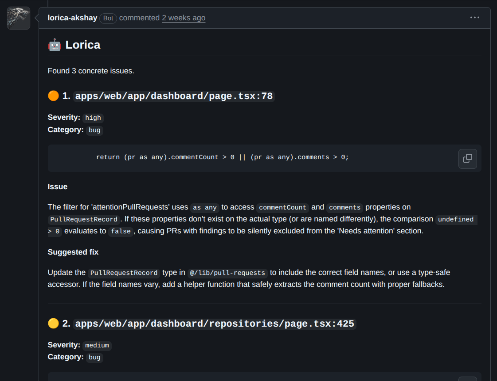

## At a glance

- **96% of real bugs identified** (86 of 90): bugs reintroduced from merged fixes in Vue, Vite, Svelte, NestJS, Zod and 5 more open-source projects ([benchmark](#benchmark)).
- **23-second median review time** on the benchmark.
- **Reviews are never lost or duplicated.** PostgreSQL is the source of truth, jobs are leased, and failed webhook deliveries are redelivered automatically.
- **Live and in production.** A hosted GitHub App, a Next.js dashboard, per-repo configuration as code, and bring-your-own model.

## Benchmark

How good is it at finding real bugs? To answer that, I took **90 merged bug-fix PRs** from 10 popular open-source repositories and **reversed each patch**, so the diff reintroduces the exact bug the maintainers fixed. Lorica reviews it exactly as in production, without seeing the PR title, description or tests. A judge model then checks whether a finding describes the actual defect.

| Metric                                                      | Result            |
| ----------------------------------------------------------- | ----------------- |
| **Bugs identified** (the finding describes the real defect) | **86 / 90 (96%)** |
| Bugs flagged (finding within 3 lines of the bug)            | 86 / 90 (96%)     |
| Valid structured responses                                  | 90 / 90 (100%)    |
| Median review time                                          | 23s               |
| Median time to index a commit into the code graph           | 26.5s             |
| Prompt tokens removed by file filtering                     | 24%               |

<sub>Repositories: Svelte, Vue, NestJS, Vite, TanStack Query, Hono, React Router, Zod, Axios, tRPC. Reviewer model: free `nvidia/nemotron-3-ultra-550b-a55b` via OpenRouter. Reproduce with `pnpm benchmark run`.</sub>

**How far to trust these numbers:**

- **The judge was checked.** Given 20 real fixes paired with findings from a _different_ case, it answered "no" every time (0/20 false matches).
- **This is an upper bound.** About half of the fixes added an explanatory comment, which the reversed diff still shows. That leak is being removed in [#26](https://github.com/Akshayshahi900/Lorica/issues/26).
- **On these small, local bugs, the code graph doesn't add much yet.** On 27 cases it scored 96% vs 93% for the diff alone. A cross-file benchmark ([#29](https://github.com/Akshayshahi900/Lorica/issues/29)) and sending callers' code to the model ([#32](https://github.com/Akshayshahi900/Lorica/issues/32)) come next.
- **Precision isn't measured yet** ([#28](https://github.com/Akshayshahi900/Lorica/issues/28)).

The full method and every individual case are in **[benchmark/REPORT.md](benchmark/REPORT.md)**.

## How it works

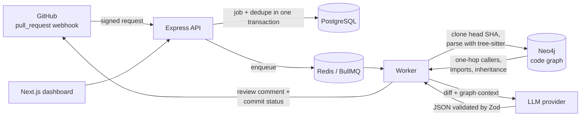

1. **Intake.** GitHub sends a signed `pull_request` webhook. The API verifies it, records the PR and a review job in PostgreSQL in the same transaction as the delivery's dedupe key, enqueues the job and responds fast.
2. **Index.** The worker checks out the head commit and parses the JavaScript/TypeScript sources with tree-sitter into a Neo4j graph of imports, calls, inheritance and implementations.
3. **Review.** Changed hunks plus graph evidence from the changed files go to the configured model in token-budgeted chunks. The JSON response must pass a Zod schema.
4. **Publish.** After re-checking that its commit is still the PR head, Lorica posts or updates its review comment and sets a `Lorica` commit status that can block merging.

## Engineering highlights

**Reliability**

- **Exactly one review per commit.** Webhook deliveries are deduplicated in the same transaction as their effects, each commit has at most one review job, and a worker must hold a lease token to publish.
- **Nothing is dropped.** Redis only carries attempts; PostgreSQL is the source of truth. A reconciler redelivers webhooks GitHub failed to deliver, so a sleeping API or a Redis outage delays reviews instead of losing them.
- **Only the current head publishes.** Out-of-order webhooks can't move a PR backwards. A newer push supersedes in-flight reviews.

**Review quality**

- **Context beyond the diff.** Graph traces give the model the callers, importers and base classes of the changed code.
- **Model output is validated, never trusted.** Severity floors and finding caps are enforced after the model answers.
- **Token-aware chunking.** Lockfiles and generated or vendored files are filtered out, and large PRs are split to fit the selected model's context window.

**Product**

- **Bring your own model:** OpenRouter, OpenAI, Anthropic, Hugging Face, Ollama or any OpenAI-compatible server. Saving a model runs a test review and rejects models that can't produce valid JSON. API keys are encrypted at rest, and user-supplied endpoints are checked so they can't reach the private network.
- **Configuration as code.** `.lorica.yaml` is read from the PR's _base_ commit, so a PR can't loosen its own review.

## Configure

Profiles (`quiet`, `chill`, `assertive`), team guidelines, per-path instructions and the merge gate can be set in the dashboard or per repository:

```yaml
# .lorica.yaml
profile: assertive
guidelines: |
  - Use the shared logger, never console.log, in services.
pathInstructions:
  - path: "src/api/**"
    instructions: Every handler validates its input with zod and checks permissions.
mergeGate:
  enabled: true
  blockOn: high
```

Every option is documented in [docs/REVIEW_SETTINGS.md](docs/REVIEW_SETTINGS.md).

## Screenshots

| Dashboard                                                  | Review history                                          |
| ---------------------------------------------------------- | ------------------------------------------------------- |
| 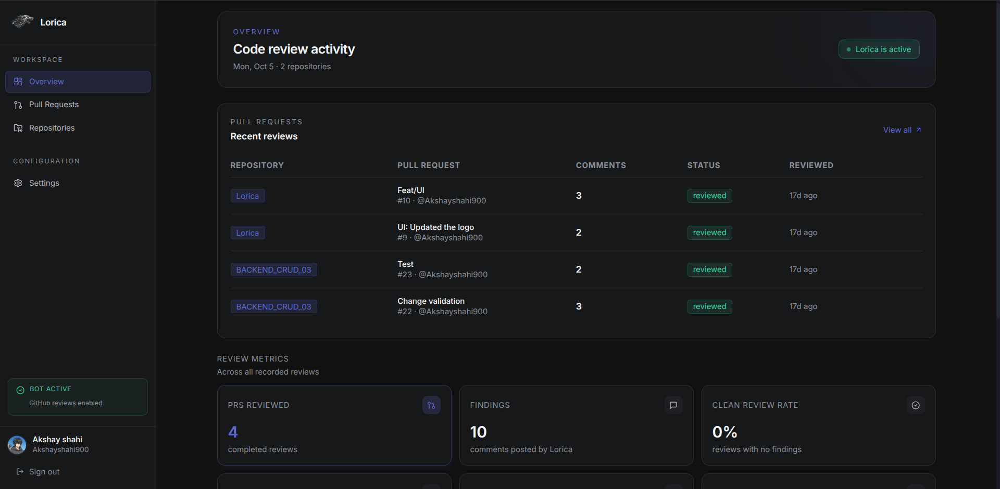 | 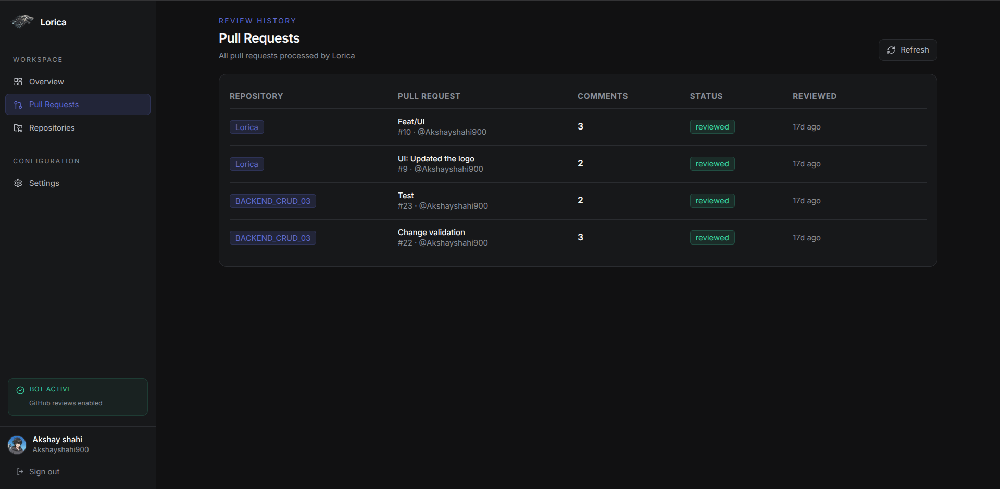  |
| **Repositories**                                           | **Settings**                                            |
| 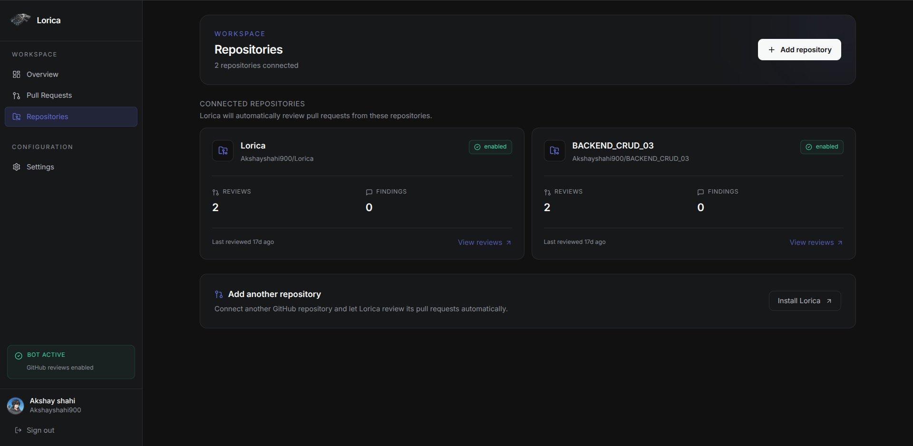 | 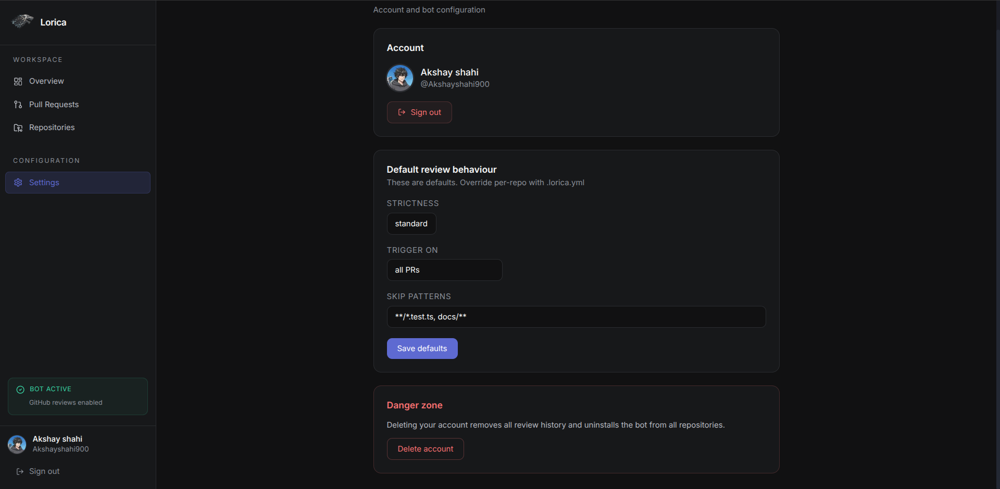 |

<details>
<summary>More screenshots</summary>

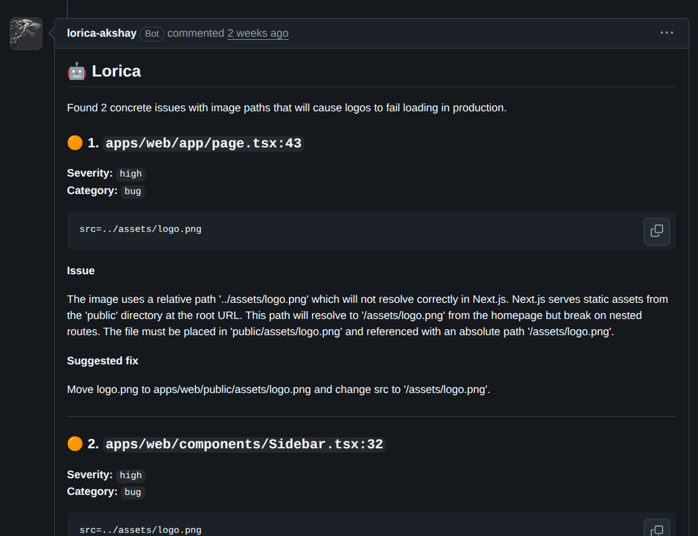
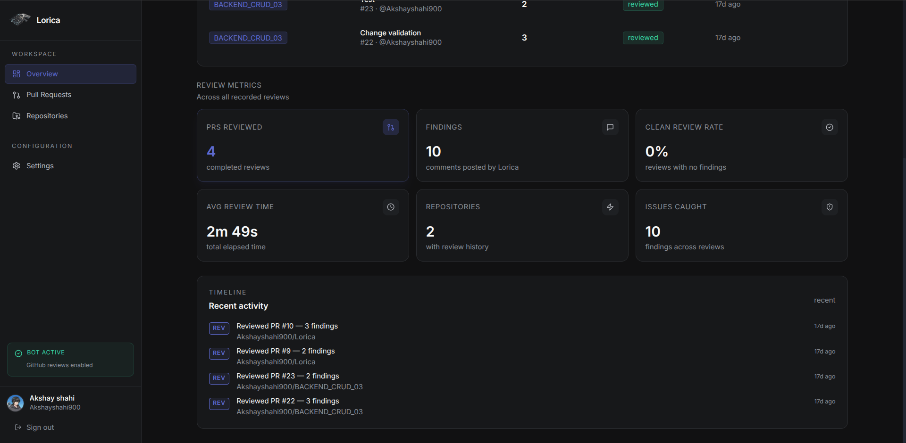
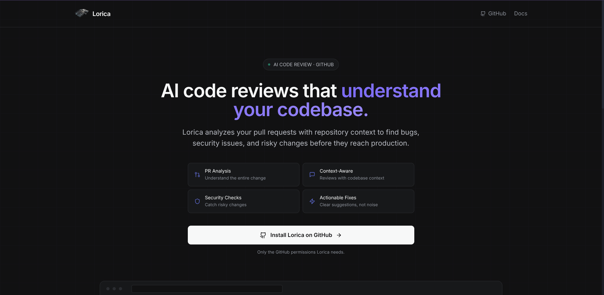
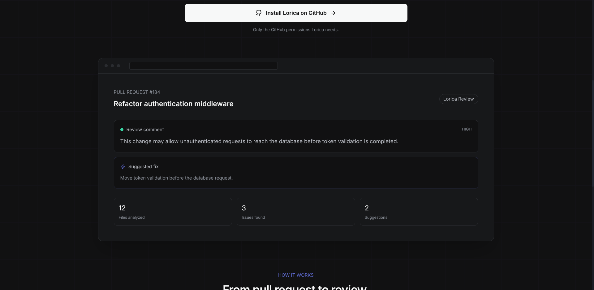
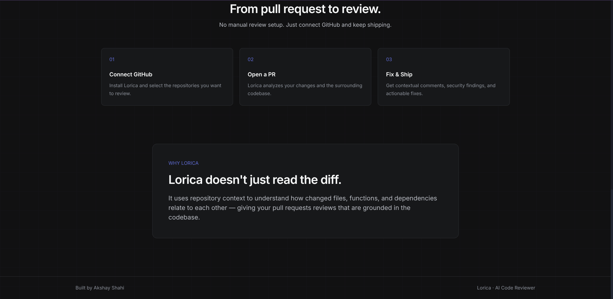

</details>

## Run it locally

Requires Node.js 20+, pnpm and Docker.

```bash
pnpm install
docker compose up -d        # PostgreSQL, Redis, Neo4j
cp .env.example .env        # then fill in the secrets
pnpm db:migrate
pnpm dev                    # web :3001, API :5000, workers
```

You also need a GitHub App, a GitHub OAuth App and a model API key (OpenRouter has a free tier). The [setup guide](docs/SETUP.md) covers each step.

## Tech stack

| Layer          | Technologies                                                     |
| -------------- | ---------------------------------------------------------------- |
| Language       | TypeScript, Node.js                                              |
| Frontend       | Next.js 14, React, Tailwind CSS, NextAuth                        |
| Backend        | Express, BullMQ, Redis, Zod                                      |
| Data           | PostgreSQL + Prisma, Neo4j, tree-sitter                          |
| AI             | OpenRouter, Anthropic, OpenAI, Ollama, any OpenAI-compatible API |
| Infrastructure | Docker, Turborepo, pnpm, GitHub Actions, Vercel, Render          |

<details>
<summary>Repository layout</summary>

```text
apps/
  api/        Express webhook intake, reconciler and dashboard-data API
  web/        Next.js 14 dashboard and GitHub OAuth
  worker/     BullMQ review worker, Neo4j code indexer, benchmark
packages/
  context/    Diff and graph-context assembly, token budgeting
  db/         Prisma schema, migrations and shared client
  llm/        Review prompt, model providers, capability checks
  queue/      BullMQ queues and Redis connection
  types/      Shared Zod schemas and TypeScript types
  vcs/        GitHub App auth, PR retrieval and comment rendering
```

</details>

## Roadmap

The full plan is tracked in **[#40](https://github.com/Akshayshahi900/Lorica/issues/40)**. The next steps:

- **Benchmark credibility:** remove the comment leak, add cross-file bugs, measure precision, and compare head-to-head against other AI reviewers
- **Smarter context:** send callers' code instead of edge names, and add an agentic mode that can read files and search the repo before commenting
- **Fewer false positives:** a verification pass that drops unproven findings, plus calibrated severity
- **Product:** inline comments with one-click suggestions, replies in PR threads, incremental reviews, PR walkthroughs
- **Security:** prompt-injection hardening, data deletion on uninstall, usage limits

## Limitations

- The code graph indexes JavaScript and TypeScript only ([#25](https://github.com/Akshayshahi900/Lorica/issues/25)), and evidence is limited to one hop from changed files.
- Findings are posted as one summary comment, not inline on individual lines ([#42](https://github.com/Akshayshahi900/Lorica/issues/42)).
- The dashboard shows pull requests whose repository owner matches the signed-in GitHub login; organization membership isn't modelled yet.
- Editing a PR's title (for example removing `WIP`) doesn't trigger a review until the next push or reopen.

## Documentation

- [Setup](docs/SETUP.md): prerequisites, environment variables, GitHub App and OAuth configuration, deployment
- [Review settings](docs/REVIEW_SETTINGS.md): profiles, `.lorica.yaml`, merge gate, post-merge actions
- [Operations](docs/OPERATIONS.md): delivery guarantees, failure recovery, scaling, HTTP API
- [Benchmark report](benchmark/REPORT.md): method, results and every case

## Author

Built by **Akshay Shahi** ([@Akshayshahi900](https://github.com/Akshayshahi900)). Feedback, issues and pull requests are welcome.

## License

[Apache License 2.0](LICENSE)
